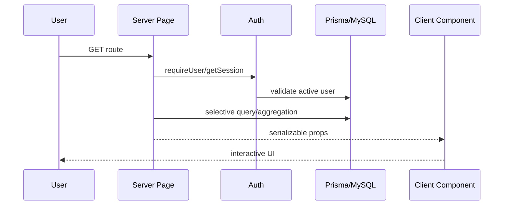
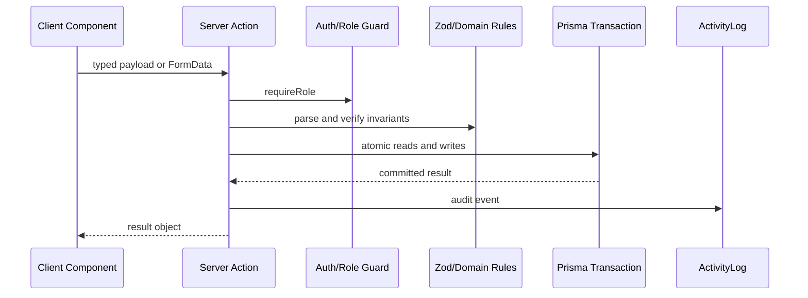

# Data Flow

## Read path

## Mutation path

## Cache
Stok akhir menggunakan `unstable_cache` selama 60 detik dengan tag `stock`. Mutasi yang memengaruhi stok memanggil `revalidateTag("stock")` dan beberapa `revalidatePath`. Dashboard gudang menetapkan `revalidate = 30`.
