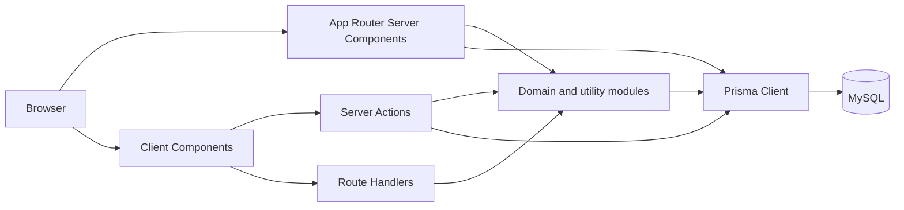

# System Architecture

Aplikasi adalah monolit Next.js. Browser mengonsumsi React Server Components, Client Components, Server Actions, dan Route Handlers dari deployment yang sama. Prisma adalah satu-satunya jalur akses database aplikasi yang ditemukan.

## Lapisan implementasi
1. `src/app`: routing, pages, layouts, Route Handlers, dan Server Actions.
2. `src/components`: UI lintas halaman dan komponen bisnis.
3. `src/lib`: auth, aturan domain, cache stok, laporan, state client, ekspor, dan utilitas.
4. `prisma/schema.prisma`: model relasional dan enum.

Tidak ditemukan service directory, middleware Next.js, queue, worker, atau scheduler server. Polling notifikasi terjadi di browser setiap 60 detik.

## Batas penting
- Auth diterapkan pada layout `(app)` dan kembali ditegakkan di sebagian besar mutasi melalui `requireRole`.
- Domain gudang dan non-gudang memiliki tabel dan alur terpisah.
- Side effect bisnis kritis dibungkus transaksi Prisma, sering dengan isolasi `Serializable`.
