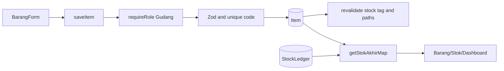

# Item and Stock Flow

Create tanpa kode menjalankan generator SKU. Edit dapat mengubah `stokAwal`; karena stok akhir adalah turunan, perubahan ini mengubah saldo seluruh histori tanpa menulis ledger. Penghapusan hanya diizinkan jika tidak ada histori transaksi, return, item pengganti, atau ledger.
