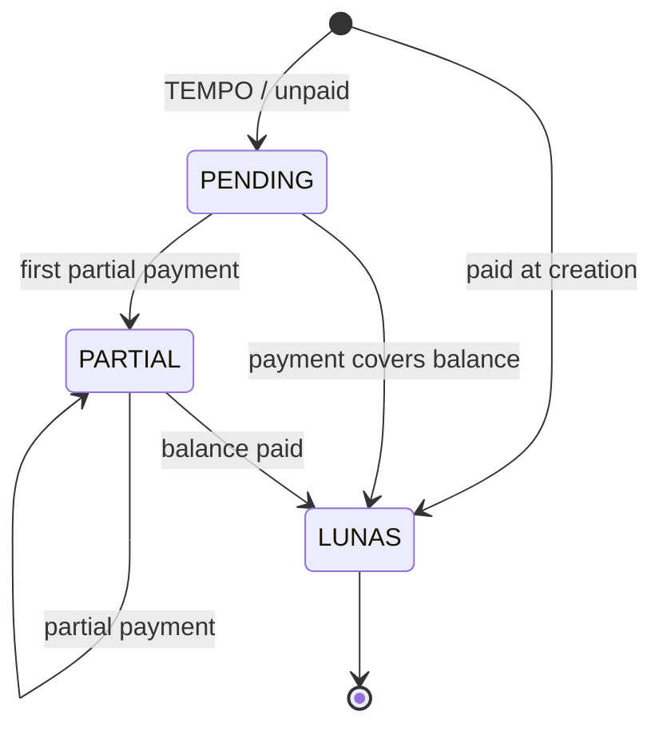

# Non-Warehouse Invoice Lifecycle

Pembayaran menggunakan transaksi Serializable dan anti-overpay. Edit mempertahankan payment history, menghitung ulang snapshots dan margin, serta menolak total penjualan di bawah total dibayar. Jatuh tempo null saat lunas; jika belum lunas, nilai lama dipertahankan atau dibuat +7 hari.
