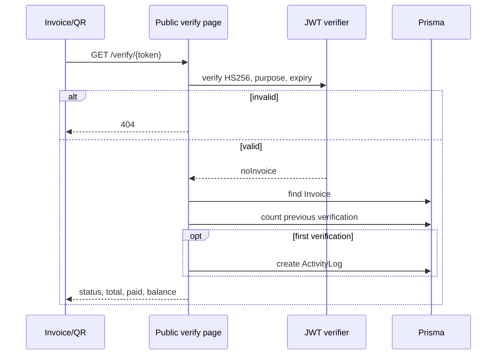

# Public Invoice Verification Flow

Token berlaku 180 hari. Halaman tidak memerlukan session karena token adalah capability. IP/user-agent hanya masuk detail activity pada verifikasi pertama; jangan dokumentasikan nilainya.
