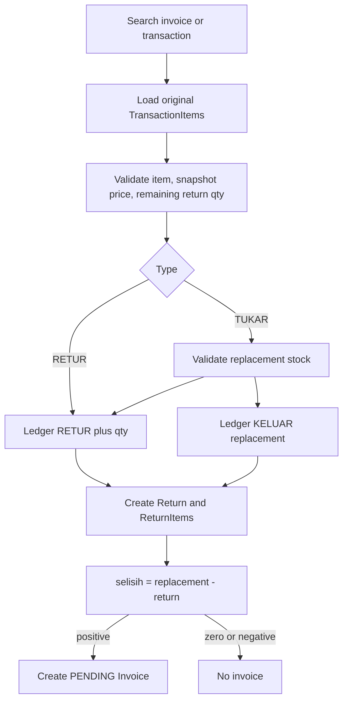

# Return and Exchange Flow

Semua write berada dalam transaksi Serializable. Cumulative return qty dihitung dari `ReturnItem` terdahulu. Pairing tukar bersifat berdasarkan index dan jumlah baris harus sama.
