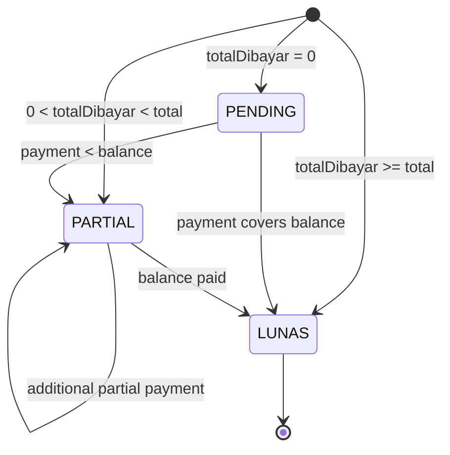

# Warehouse Invoice Lifecycle

`DRAFT` ada dalam enum tetapi tidak ditemukan pada action penciptaan aktif. Payment di-clamp ke sisa. Edit line dapat mengubah total dan status, tetapi total baru tidak boleh di bawah totalDibayar. Delete dapat menghapus seluruh graph transaction/return/ledger/payment yang menjadi sumber invoice.
