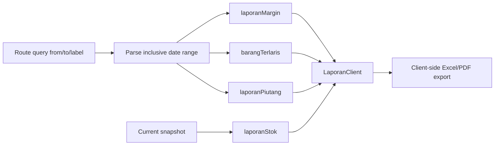

# Warehouse Reporting Flow

Margin memakai harga jual dan harga beli snapshot dari `TransactionItem`. Piutang memakai `Invoice.total - totalDibayar`. Stok tidak historis dan tidak mengikuti date range.
