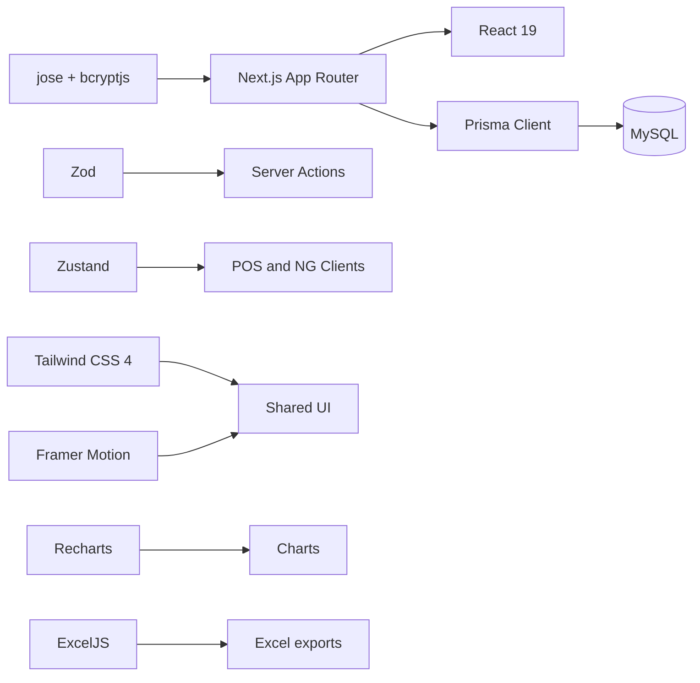

# Dependency Graph

## Tidak ditemukan dipakai di `src`
`@tanstack/react-query`, `@tanstack/react-table`, dan `react-hook-form` tercantum di manifest tetapi pencarian symbol/import tidak menemukan usage. Jangan hapus tanpa build/audit package menyeluruh; catat di [[Technical-Debt]].
