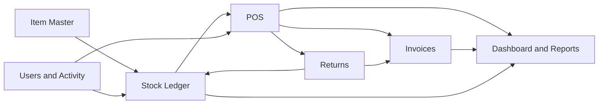
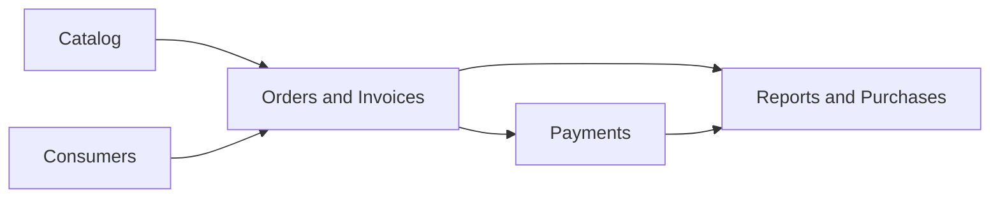

# Module Graph

## Gudang

## Non-gudang

Wikilinks: [[Item-Master]], [[Stock-Ledger]], [[POS-Transactions]], [[Returns-and-Exchanges]], [[Warehouse-Invoices-and-Receivables]], [[Non-Warehouse-Catalog]], [[Non-Warehouse-Consumers]], [[Non-Warehouse-Orders-and-Invoices]].
