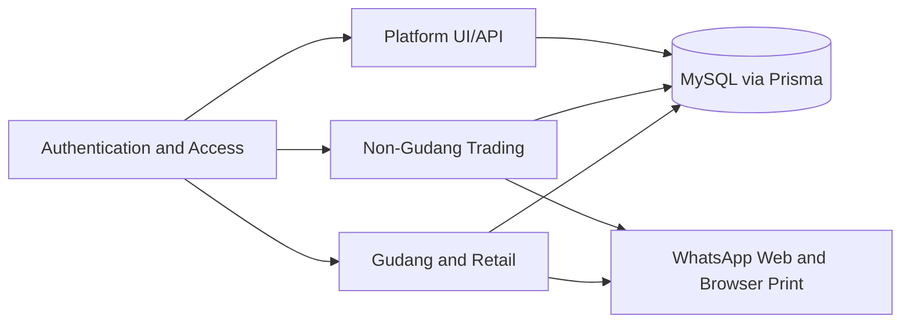

# System Graph

## Native graph anchors
- Auth: [[Authentication-and-Access]], [[Authentication]], [[Authorization]]
- Gudang: [[Item-Master]], [[Stock-Ledger]], [[POS-Transactions]], [[Returns-and-Exchanges]], [[Warehouse-Invoices-and-Receivables]]
- Non-gudang: [[Non-Warehouse-Catalog]], [[Non-Warehouse-Consumers]], [[Non-Warehouse-Orders-and-Invoices]]
- Platform: [[Search-and-Notifications]], [[Printing-and-Invoice-Verification]]
